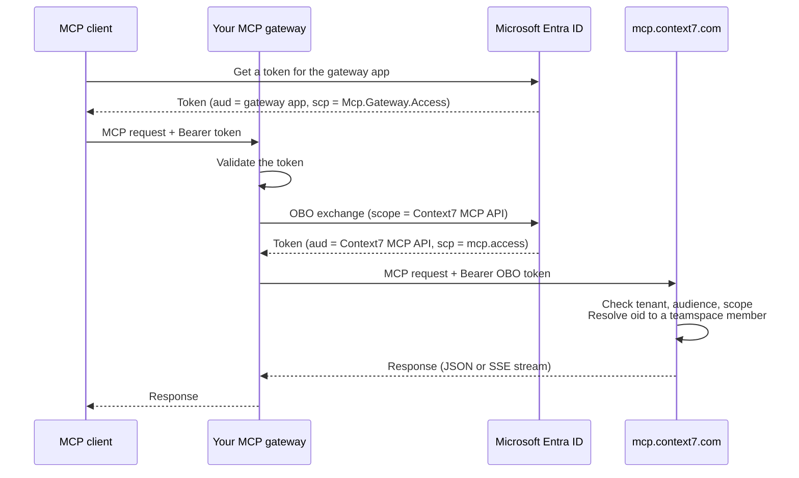

<Note>
This setup is optional, and you do not need it for single sign-on. To let your team sign in to Context7 with Microsoft Entra ID, follow [Microsoft Entra ID SSO](/enterprise/enterprise-managed-auth/entra-sso). If your gateway is Azure API Management, follow [Azure APIM gateway](/enterprise/enterprise-managed-auth/entra), which has ready-made APIM policies.
</Note>

Use this guide when all MCP traffic in your company goes through your own MCP gateway, and Microsoft Entra ID is the identity provider behind it. The gateway can be an internal platform, a policy engine, or a commercial product. Context7 serves each request as the developer who made it, through the `oid` claim of their Entra token.

## How it works

Your gateway uses the On-Behalf-Of (OBO) flow. The developer's MCP client gets an Entra token for your gateway. Your gateway exchanges that token for a second Entra token for the **Context7 MCP API** app in your tenant, and sends the second token to Context7.



<Warning>
Your gateway must not send the developer's own token to Context7. That token is issued for your gateway, so Context7 rejects it with `401` and `Unknown audience`. Always send the OBO token.
</Warning>

## Before you start

You need:

- A **Context7 Enterprise teamspace** or an Enterprise trial. The dashboard shows the **Enterprise** tab only on these teamspaces.
- An **Entra admin** who can register applications and grant admin consent.
- An **MCP gateway** that can validate a JWT, call the Entra token endpoint, and forward Streamable HTTP, including Server-Sent Events.
- **Network access** from the gateway to `https://mcp.context7.com` and `https://login.microsoftonline.com`.

## Step 1: Register the Context7 MCP API app

This app stands for Context7 in your tenant. The OBO token carries its Application (client) ID as the `aud` claim.

1. **Microsoft Entra admin center** → **App registrations** → **+ New registration**.
   - **Name:** `Context7 MCP API`
   - **Supported account types:** Single tenant only
   - **Redirect URI:** leave it empty.
2. Copy the **Application (client) ID**. You enter it in Context7 in Step 3.
3. **Expose an API** → **Add** next to "Application ID URI" → keep `api://<client-id>` → **Save**.
4. **+ Add a scope**: name `mcp.access`, **Who can consent:** Admins and users, **State:** Enabled.
5. **Manifest** → set `requestedAccessTokenVersion` to `2` under `api` → **Save**.

<Warning>
Context7 accepts only v2 tokens, with the issuer `https://login.microsoftonline.com/<tenant-id>/v2.0`, signed with RS256. Apps with custom signing keys are not supported. If tokens still show `ver: 1.0`, run `az ad app update --id <client-id> --set api.requestedAccessTokenVersion=2`.
</Warning>

## Step 2: Register your gateway app

This app stands for your gateway. MCP clients get tokens for it, and the gateway uses its client secret for the OBO exchange. If your gateway already has an Entra app, use that app and add what is missing.

1. **App registrations** → **+ New registration**, single tenant. Copy the **Application (client) ID** and the **Directory (tenant) ID**.
2. **Expose an API** → keep `api://<gateway-client-id>` → add the scope `Mcp.Gateway.Access`.
3. **Manifest** → set `requestedAccessTokenVersion` to `2`.
4. **Certificates & secrets** → **+ New client secret**. Store the value in your gateway's secret store. Entra shows it only once.
5. **API permissions** → **+ Add a permission** → **My APIs** → **Context7 MCP API** → **Delegated permissions** → `mcp.access` → **Add permissions**. Then click **Grant admin consent**.
6. In the **Context7 MCP API** app: **Expose an API** → **Authorized client applications** → add the gateway app's client ID with the `mcp.access` scope. Users then see no extra consent prompt during the OBO exchange.
7. In the gateway app: **Expose an API** → **Authorized client applications** → add the client ID of each MCP client you allow, with the `Mcp.Gateway.Access` scope. For the smoke test in Step 6, add the Azure CLI: `04b07795-8ddb-461a-bbee-02f9e1bf7b46`.

## Step 3: Configure your teamspace in Context7

An owner or admin of the teamspace does this in the dashboard. Context7 checks every OBO token in two stages, and both are mandatory:

1. The token's signature, issuer, audience and scope must match the teamspace's tenant configuration.
2. The token's `oid` must belong to a user on the teamspace's Entra user list. Context7 rejects any other user with `401`, even when the token is valid.

To configure it:

1. Open [context7.com/dashboard](https://context7.com/dashboard) and select the teamspace.
2. **Enterprise** tab → **Microsoft Entra ID** → **Configure**, and fill in:
   - **Tenant ID:** your Directory (tenant) ID.
   - **Audience:** the **Context7 MCP API** app's client ID from Step 1. Do not use the gateway app's ID.
   - **Required scope:** `mcp.access`
3. Click **Test connection**, then **Save**.
4. Add your developers in the **Microsoft Entra ID users** card. You can add each user by email and Entra object ID, or sync an Entra security group every 30 minutes. For the group sync setup, see [Auto-provision from an Entra security group](/enterprise/enterprise-managed-auth/entra#step-3-auto-provision-from-an-entra-security-group-optional).

<Note>
One Context7 MCP API app (audience) belongs to one teamspace. To connect a second teamspace, register a second Context7 MCP API app.
</Note>

## Step 4: Configure your gateway

Your gateway must do these six things for each request to Context7:

1. **Validate the incoming token.** Check the signature against your tenant's keys (`https://login.microsoftonline.com/<tenant-id>/discovery/v2.0/keys`), the issuer, `aud` = the gateway app's client ID, and `scp` contains `Mcp.Gateway.Access`. If the token is missing or not valid, answer `401` with a challenge (see Step 5).
2. **Exchange the token On-Behalf-Of the user.** Send this request to Entra:

   ```bash
   curl -X POST "https://login.microsoftonline.com/<tenant-id>/oauth2/v2.0/token" \
     -d grant_type=urn:ietf:params:oauth:grant-type:jwt-bearer \
     -d client_id=<gateway-client-id> \
     -d client_secret=<gateway-client-secret> \
     -d assertion=<incoming user token> \
     -d scope=api://<context7-mcp-api-client-id>/mcp.access \
     -d requested_token_use=on_behalf_of
   ```

3. **Cache the OBO token per user.** Key the cache by the user's `oid`, and renew the token a minute before its `exp`. Without a cache, every MCP message causes one more call to Entra.
4. **Forward the request** to `https://mcp.context7.com/mcp`, with the same method, body and headers, and `Authorization: Bearer <OBO token>` in place of the user's token. Do not change `Accept` or `Content-Type`.
5. **Stream the response.** Context7 answers with JSON or with a Server-Sent Events stream. Pass the body through without buffering, and do not set a short read timeout.
6. **Pass status codes through.** A `401` from Context7 means the configuration or the user mapping is wrong (see [Troubleshooting](#troubleshooting)). A `405` on `GET` is normal: the server has no standalone event stream, and clients continue without it.

Facts that help when you set rules in the gateway:

- The server is read-only and has two tools: `resolve-library-id` and `query-docs`.
- The server is stateless. It sends no `Mcp-Session-Id`, so the gateway needs no sticky sessions.

## Step 5: Expose OAuth discovery for MCP clients

MCP clients find out how to sign in from the gateway. Your gateway must:

1. Answer a request without a token with `401` and this header:

   ```
   WWW-Authenticate: Bearer resource_metadata="https://<gateway-host>/.well-known/oauth-protected-resource<mcp-path>"
   ```

2. Serve that document, with your gateway's MCP URL as `resource`:

   ```json
   {
     "resource": "https://<gateway-host><mcp-path>",
     "authorization_servers": ["https://login.microsoftonline.com/<tenant-id>/v2.0"],
     "scopes_supported": ["api://<gateway-client-id>/Mcp.Gateway.Access"],
     "bearer_methods_supported": ["header"]
   }
   ```

Entra does not support Dynamic Client Registration. Each MCP client must use a client ID that you registered or pre-authorized in Step 2, and some clients ask the user for that ID the first time. Some clients also need an authorization server metadata at the gateway's own host. The [Azure APIM gateway](/enterprise/enterprise-managed-auth/entra#part-5-expose-oauth-discovery-for-mcp-clients) guide shows how to proxy it, and the same pattern works on other gateways.

## Step 6: Smoke test

Test the whole chain from a terminal before you connect MCP clients:

```bash
az login --tenant <tenant-id>

TOKEN=$(az account get-access-token \
  --scope "api://<gateway-client-id>/Mcp.Gateway.Access" \
  --query accessToken -o tsv)

curl -i -X POST "https://<gateway-host><mcp-path>" \
  -H "Authorization: Bearer $TOKEN" \
  -H "Content-Type: application/json" \
  -H "Accept: application/json, text/event-stream" \
  -d '{"jsonrpc":"2.0","id":1,"method":"initialize","params":{"protocolVersion":"2025-06-18","capabilities":{},"clientInfo":{"name":"smoke","version":"0.0.1"}}}'
```

The expected answer is `200 OK` with an event stream that names the Context7 server. Then call `tools/list` and one `query-docs` through your MCP client to see real documentation.

## Token claims

| Hop | `iss` | `aud` | `scp` | `oid` |
|---|---|---|---|---|
| MCP client → gateway | `https://login.microsoftonline.com/<tid>/v2.0` | gateway app client ID | `Mcp.Gateway.Access` | the user's object ID |
| Gateway → Context7 | `https://login.microsoftonline.com/<tid>/v2.0` | Context7 MCP API client ID | `mcp.access` | the same object ID |

## Troubleshooting

| Symptom | Cause | Fix |
|---|---|---|
| `401` "Unknown audience" from Context7 | The gateway sent the user's own token, or the audience in Context7 is not the Context7 MCP API app's ID. | Send the OBO token. In Context7, set **Audience** to the Context7 MCP API client ID. |
| `401` from Context7 with a valid OBO token | The `oid` is not on the teamspace's user list, or the tenant or scope does not match. | Decode the OBO token. Compare `tid`, `aud` and `scp` with the **Microsoft Entra ID** card on the **Enterprise** tab, and add the `oid` under **Microsoft Entra ID users**. |
| OBO returns `AADSTS65001` or `AADSTS50013` | No admin consent, or the gateway app is not authorized on the Context7 MCP API app. | Repeat Step 2, items 5 and 6. |
| OBO returns `AADSTS70011` (invalid scope) | Wrong scope string. | Use `api://<context7-mcp-api-client-id>/mcp.access`. |
| Tokens show `ver: 1.0` | The app still issues v1 tokens. | Set `requestedAccessTokenVersion` to `2` on both apps. |
| Answers stop in the middle | The gateway buffers the stream or closes it early. | Stream the body through and raise the read timeout. |

## What this does not cover

- **Context7's own OAuth through a pass-through gateway.** If your gateway only passes the client's sign-in through to Context7's OAuth, the token is issued for the gateway's URL and Context7 rejects it. Use the Entra flow in this guide, or give the gateway a Context7 API key if one shared identity is enough.
- **SCIM provisioning.** Context7 does not support SCIM yet. Use the Entra security group sync to add and remove users.
- **On-premise.** This guide proxies the hosted `mcp.context7.com`. For an on-premise deployment, contact [context7@upstash.com](mailto:context7@upstash.com).
